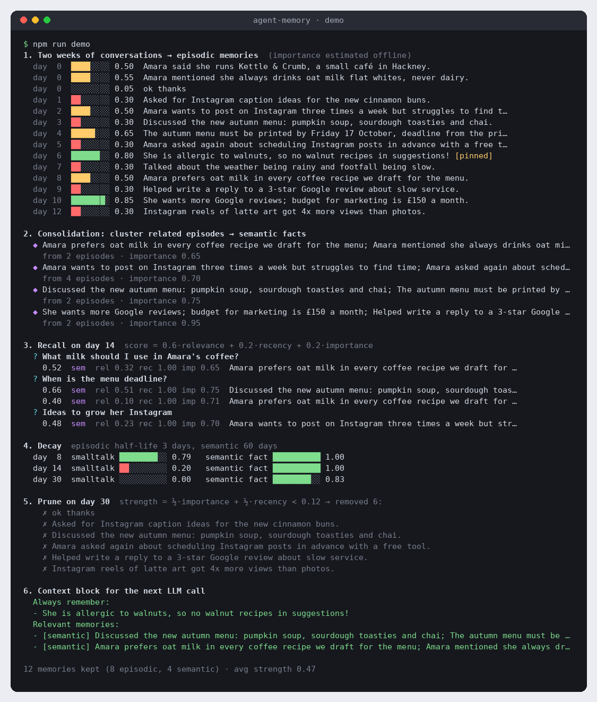

<div align="center">

# 🧠 agent-memory

**Long-term memory for AI agents: episodic and semantic stores, TF-IDF retrieval, decay and importance scoring, and consolidation. Zero runtime dependencies.**

[](https://github.com/hbtabi/agent-memory/actions/workflows/ci.yml)


-412991?logo=openai&logoColor=white)
[](LICENSE)

</div>

Chat history is not memory. An agent that helps someone for weeks needs to keep the things that matter (allergies,
preferences, deadlines) and let small talk fade. Repeated observations should become durable facts, and a prompt
should only carry what is relevant right now.

**agent-memory** is a small, readable memory layer that does exactly that:

- **Episodic memories** record events ("asked about Instagram scheduling on Tuesday") and decay quickly
- **Semantic memories** hold durable facts ("prefers oat milk, never dairy") and decay slowly
- **Retrieval** ranks memories by `0.6·relevance + 0.2·recency + 0.2·importance`. Relevance is TF-IDF cosine, recency is exponential decay, and importance is heuristic or user-set, boosted each time a memory is recalled
- **Consolidation** clusters related episodes and distils each cluster into a semantic fact. The offline summariser is extractive; an LLM is optional
- **Pruning** forgets weak memories. Pinned memories are never pruned and always reach the prompt
- **JSON file backend** with atomic writes, or bring your own store

It runs fully offline. Set `OPENAI_API_KEY` to have any OpenAI-compatible model write the consolidated facts.

## 📸 Demo

<p align="center"></p>

The demo (`npm run demo`) simulates 30 days with an injected clock for a fictional café owner. Small talk decays and
gets pruned. Repeated Instagram questions become one semantic fact. The walnut allergy is pinned, so it reaches the
prompt even when the query ("coffee recipe for the autumn menu") shares no words with it.

## 🚀 Quick start

```bash
git clone https://github.com/hbtabi/agent-memory && cd agent-memory
npm install
npm test          # build + node:test suite
npm run demo      # offline, simulated 30 days
npm run example   # minimal agent loop (examples/basic.ts)
```

### Library

```ts
import { AgentMemory } from "agent-memory"; // npm install github:hbtabi/agent-memory

const memory = await AgentMemory.open("./agent.memory.json");

memory.remember("Sam runs a dog-walking business in Peckham", { kind: "semantic" });
memory.remember("Sam is allergic to cats", { kind: "semantic", pinned: true });
memory.remember("Sam asked for spring flyer copy", { tags: ["marketing"] }); // importance estimated automatically

const hits = memory.recall("write an Instagram post for the dog-walking business", { k: 3 });
// [{ memory, score: { relevance, recency, importance, total } }, ...]

const context = memory.buildContext(userMessage, { k: 5, maxChars: 1200 }); // drop straight into your prompt
await memory.consolidate();      // episodes → semantic facts
memory.prune({ maxItems: 500 }); // forget the weakest
await memory.save();
```

### CLI

```bash
npm link    # exposes the `agent-memory` command (or run: node dist/src/cli.js ...)

agent-memory add "Amara prefers oat milk" --kind semantic --tags coffee
agent-memory recall "what milk does Amara like?" -k 3
agent-memory context "draft a coffee recipe"
agent-memory list --kind episodic
agent-memory consolidate --similarity 0.3
agent-memory prune --min-strength 0.15
agent-memory stats
```

All commands take `--file <path>` (default `./agent.memory.json`).

### Optional LLM consolidation

```bash
export OPENAI_API_KEY=sk-...
export OPENAI_BASE_URL=https://api.openai.com/v1   # or Ollama / LM Studio / OpenRouter
export AGENT_MEMORY_MODEL=gpt-4o-mini
agent-memory consolidate
```

Set `AGENT_MEMORY_OFFLINE=1` to force the extractive summariser. If an API call fails, it falls back to extractive
automatically.

## ⚙️ How it works

| Piece | Implementation |
|---|---|
| Tokeniser | lowercase, accent folding, stop-words, light suffix stemmer (`prefers → prefer`, `whites → white`) |
| Index | incremental TF-IDF (sublinear tf, smoothed idf, L2-normalised sparse vectors), O(terms) add/remove |
| Recency | `0.5 ^ (age / halfLife)`, using the later of creation and last access. Half-life is 3 days (episodic) or 60 days (semantic) |
| Importance | caller-supplied, or a heuristic (preferences, allergies, deadlines, money, dates…) plus `0.08·ln(1+accessCount)` |
| Dedupe | a new memory with cosine ≥ 0.9 to one of the same kind reinforces it instead |
| Consolidation | greedy single-link clustering on cosine, then the `Summarizer` writes a semantic fact. Source episodes are tagged and down-weighted, and hidden behind their fact in recall |
| Strength (pruning) | `½·importance + ½·recency`, with pinned memories exempt |
| Storage | `MemoryStore` interface: `JsonFileStore` (atomic temp-file + rename) and `InMemoryStore` |

All weights and half-lives can be configured via `new AgentMemory({ scoring: { ... } })`.

> **Limits:** TF-IDF is lexical, so "automobile" won't match "car". That's what pinning and consolidation help with,
> and an embeddings adapter is on the roadmap.

## 🗂️ Project structure

```
agent-memory/
├── src/
│   ├── memory.ts       # AgentMemory: remember / recall / buildContext / consolidate / prune / stats
│   ├── tfidf.ts        # incremental TF-IDF index + cosine similarity
│   ├── tokenize.ts     # tokenizer + stemmer
│   ├── scoring.ts      # decay, importance heuristic, strength
│   ├── summarizer.ts   # extractive (offline) + OpenAI-compatible summariser
│   ├── store.ts        # JSON file + in-memory stores
│   ├── demo.ts         # simulated 30-day demo
│   ├── cli.ts          # agent-memory CLI
│   └── index.ts        # public API
├── examples/basic.ts   # minimal agent loop
├── test/               # node:test suites (incl. a local fake LLM server)
└── docs/demo.png
```

## 🛣️ Roadmap

- [ ] Pluggable embeddings (hybrid BM25 + vector) behind the same `recall()` API
- [ ] SQLite store for 100k+ memories
- [ ] Per-user namespaces and memory export/import
- [ ] Contradiction handling: newer semantic facts supersede older ones
- [ ] MCP server so any agent framework can use it as a tool

## 📄 Licence

[MIT](LICENSE) © 2026 Mohammed Hassan bin Tayyeb. People and businesses in the demo are fictional.
